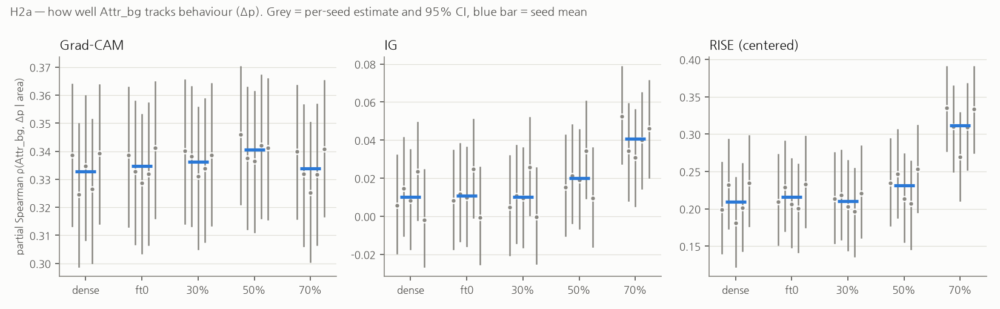
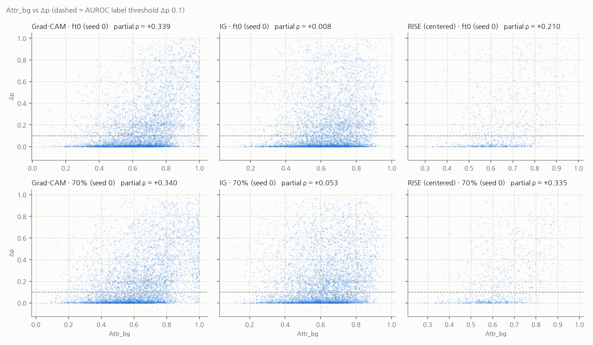
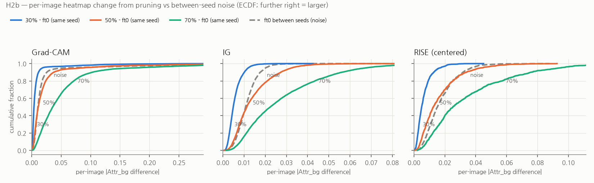

# STEP 5 — 히트맵 채점 (H2a, H2b)

**보조 분석 — seed 0 1 2 3 4** (PREREG_seeds5.md). 주 판정은 seed 0~2 의 `results/attribution_k5.md` 다.

생성: `analyze_h2.py`. 방법·판정 규칙은 CLAUDE.md §4 "2026-11-10 결정 사항" 4, 추가 결정 11.

- 이미지: Grad-CAM·IG 5,794장, RISE 1,000장 (`results/rise_images.csv`). RISE 의 Attr_bg 는 centered 맵.
- 행동 지표 Δp 는 이미지별 (물 배경 반사실 평균 p(waterbird) − 땅 배경 평균). AUROC 정답 = Δp ≥ 0.1.
- CI: 이미지 bootstrap 2000회 (모든 모델이 같은 재표본 인덱스 → ft0 대비 차이가 짝지어진다).
- 값은 Attr_bg 기준. **양수 ρ = 배경 attribution 이 큰 이미지일수록 배경 의존(Δp)도 크다 (추적).**

## 판정 요약

| 방법 | H2a 70% (seed 별 방향) | ft0 ρ | 70% ρ | Δρ 70%−ft0 [CI] | H2b 70% 중앙값 차이 [CI] | 평균 Attr_bg 변화 [CI] | H1 70% |
| --- | --- | --- | --- | --- | --- | --- | --- |
| Grad-CAM | 지지 안 됨 (· · · · ·) | +0.335 | +0.334 | -0.001 [-0.017, +0.015] | +0.025 [+0.024, +0.026] | -0.031 [-0.033, -0.029] | 변함: d_wrong |
| IG | 지지 안 됨 (↑ · · · ↑) | +0.011 | +0.041 | +0.030 [+0.018, +0.043] | +0.012 [+0.011, +0.012] | -0.016 [-0.017, -0.015] | 변함: d_wrong |
| RISE (centered) | 반대 (추적 강화) (↑ ↑ ↑ ↑ ↑) | +0.216 | +0.312 | +0.096 [+0.056, +0.134] | +0.010 [+0.008, +0.012] | -0.010 [-0.013, -0.007] | 변함: d_wrong |

- H2a 방향 기호: ↓ = 70% 가 같은 seed ft0 의 95% CI 아래, ↑ = 위, · = 안. 3개 이상 ↓ 면 지지.
- H2b 중앙값 차이 > 0 이고 CI 가 0 을 넘으면 압축에 따른 히트맵 변화가 seed 간 잡음보다 크다.
- 평균 Attr_bg 변화 < 0 = 히트맵이 새 쪽으로 이동.

## H2a — 모델별 추적 지표

### Grad-CAM

| 모델 | 부분 ρ seed 0 [CI] | seed 1 [CI] | seed 2 [CI] | seed 3 [CI] | seed 4 [CI] | 평균 | 원시 Spearman | AUROC | 부분 ρ (C) | ft0 대비 Δ (seed 평균) [CI] | 판정 |
| --- | --- | --- | --- | --- | --- | --- | --- | --- | --- | --- | --- |
| dense | +0.339 [+0.313, +0.364] | +0.325 [+0.299, +0.350] | +0.335 [+0.308, +0.360] | +0.327 [+0.300, +0.351] | +0.339 [+0.314, +0.364] | +0.333 | +0.435 | 0.714 | -0.303 | - | - |
| ft0 | +0.339 [+0.313, +0.363] | +0.333 [+0.307, +0.358] | +0.329 [+0.304, +0.353] | +0.332 [+0.307, +0.357] | +0.341 [+0.316, +0.365] | +0.335 | +0.439 | 0.715 | -0.304 | - | - |
| 30% | +0.340 [+0.314, +0.365] | +0.338 [+0.313, +0.363] | +0.331 [+0.305, +0.356] | +0.334 [+0.308, +0.359] | +0.339 [+0.314, +0.364] | +0.336 | +0.444 | 0.717 | -0.305 | +0.002 [-0.004, +0.008] | 지지 안 됨 (· · · · ·) |
| 50% | +0.346 [+0.321, +0.370] | +0.338 [+0.312, +0.363] | +0.337 [+0.311, +0.361] | +0.342 [+0.316, +0.367] | +0.341 [+0.316, +0.366] | +0.341 | +0.440 | 0.712 | -0.315 | +0.006 [-0.005, +0.016] | 지지 안 됨 (· · · · ·) |
| 70% | +0.340 [+0.316, +0.363] | +0.332 [+0.306, +0.357] | +0.325 [+0.301, +0.350] | +0.332 [+0.307, +0.357] | +0.341 [+0.317, +0.365] | +0.334 | +0.413 | 0.700 | -0.313 | -0.001 [-0.017, +0.015] | 지지 안 됨 (· · · · ·) |

보조 지표의 ft0 대비 판정 (같은 규칙)

| 모델 | 원시 Spearman | AUROC | 부분 ρ (C) |
| --- | --- | --- | --- |
| 30% | 지지 안 됨 (· · · · ·) | 지지 안 됨 (· · · · ·) | 지지 안 됨 (· · · · ·) |
| 50% | 지지 안 됨 (· · · · ·) | 지지 안 됨 (· · · · ·) | 지지 안 됨 (· · · · ·) |
| 70% | 지지 (추적 약화) (↓ ↓ ↓ ↓ ·) | 지지 (추적 약화) (↓ ↓ · ↓ ·) | 지지 안 됨 (· · · · ·) |

C 는 높을수록 새에 집중이므로 추적이면 ρ 가 음수다. 판정 문구의 '약화/강화' 는 ρ 값의 증감 기준이다.

### IG

| 모델 | 부분 ρ seed 0 [CI] | seed 1 [CI] | seed 2 [CI] | seed 3 [CI] | seed 4 [CI] | 평균 | 원시 Spearman | AUROC | 부분 ρ (C) | ft0 대비 Δ (seed 평균) [CI] | 판정 |
| --- | --- | --- | --- | --- | --- | --- | --- | --- | --- | --- | --- |
| dense | +0.006 [-0.019, +0.032] | +0.015 [-0.010, +0.042] | +0.008 [-0.017, +0.035] | +0.023 [-0.002, +0.049] | -0.002 [-0.026, +0.025] | +0.010 | +0.214 | 0.608 | -0.015 | - | - |
| ft0 | +0.008 [-0.017, +0.035] | +0.012 [-0.013, +0.038] | +0.010 [-0.016, +0.036] | +0.025 [-0.001, +0.051] | -0.001 [-0.025, +0.026] | +0.011 | +0.217 | 0.609 | -0.016 | - | - |
| 30% | +0.005 [-0.021, +0.032] | +0.011 [-0.014, +0.037] | +0.010 [-0.016, +0.036] | +0.026 [+0.001, +0.052] | -0.000 [-0.025, +0.026] | +0.010 | +0.221 | 0.611 | -0.014 | -0.001 [-0.004, +0.002] | 지지 안 됨 (· · · · ·) |
| 50% | +0.015 [-0.010, +0.043] | +0.021 [-0.003, +0.048] | +0.019 [-0.006, +0.045] | +0.034 [+0.010, +0.060] | +0.010 [-0.016, +0.036] | +0.020 | +0.218 | 0.612 | -0.025 | +0.009 [+0.002, +0.017] | 지지 안 됨 (· · · · ·) |
| 70% | +0.053 [+0.028, +0.079] | +0.034 [+0.008, +0.059] | +0.031 [+0.006, +0.056] | +0.040 [+0.015, +0.065] | +0.046 [+0.020, +0.071] | +0.041 | +0.205 | 0.606 | -0.049 | +0.030 [+0.018, +0.043] | 지지 안 됨 (↑ · · · ↑) |

보조 지표의 ft0 대비 판정 (같은 규칙)

| 모델 | 원시 Spearman | AUROC | 부분 ρ (C) |
| --- | --- | --- | --- |
| 30% | 지지 안 됨 (· · · · ·) | 지지 안 됨 (· · · · ·) | 지지 안 됨 (· · · · ·) |
| 50% | 지지 안 됨 (· · · · ·) | 지지 안 됨 (· · · · ·) | 지지 안 됨 (· · · · ·) |
| 70% | 지지 안 됨 (· ↓ · · ·) | 지지 안 됨 (· · · · ·) | 지지 (추적 약화) (↓ · ↓ · ↓) |

C 는 높을수록 새에 집중이므로 추적이면 ρ 가 음수다. 판정 문구의 '약화/강화' 는 ρ 값의 증감 기준이다.

### RISE (centered)

| 모델 | 부분 ρ seed 0 [CI] | seed 1 [CI] | seed 2 [CI] | seed 3 [CI] | seed 4 [CI] | 평균 | 원시 Spearman | AUROC | 부분 ρ (C) | ft0 대비 Δ (seed 평균) [CI] | 판정 |
| --- | --- | --- | --- | --- | --- | --- | --- | --- | --- | --- | --- |
| dense | +0.199 [+0.141, +0.262] | +0.232 [+0.174, +0.293] | +0.181 [+0.123, +0.242] | +0.202 [+0.144, +0.260] | +0.235 [+0.177, +0.298] | +0.210 | +0.365 | 0.680 | -0.230 | - | - |
| ft0 | +0.210 [+0.151, +0.273] | +0.229 [+0.170, +0.290] | +0.206 [+0.149, +0.267] | +0.200 [+0.142, +0.260] | +0.233 [+0.175, +0.297] | +0.216 | +0.370 | 0.679 | -0.236 | - | - |
| 30% | +0.213 [+0.154, +0.275] | +0.218 [+0.159, +0.279] | +0.203 [+0.145, +0.265] | +0.196 [+0.136, +0.254] | +0.221 [+0.162, +0.284] | +0.210 | +0.372 | 0.681 | -0.234 | -0.005 [-0.013, +0.003] | 지지 안 됨 (· · · · ·) |
| 50% | +0.235 [+0.178, +0.294] | +0.247 [+0.188, +0.306] | +0.213 [+0.156, +0.274] | +0.207 [+0.146, +0.264] | +0.253 [+0.195, +0.311] | +0.231 | +0.380 | 0.694 | -0.251 | +0.015 [-0.005, +0.035] | 지지 안 됨 (· · · · ·) |
| 70% | +0.335 [+0.278, +0.390] | +0.310 [+0.250, +0.365] | +0.270 [+0.211, +0.329] | +0.309 [+0.253, +0.368] | +0.334 [+0.275, +0.390] | +0.312 | +0.402 | 0.709 | -0.325 | +0.096 [+0.056, +0.134] | 반대 (추적 강화) (↑ ↑ ↑ ↑ ↑) |

보조 지표의 ft0 대비 판정 (같은 규칙)

| 모델 | 원시 Spearman | AUROC | 부분 ρ (C) |
| --- | --- | --- | --- |
| 30% | 지지 안 됨 (· · · · ·) | 지지 안 됨 (· · · · ·) | 지지 안 됨 (· · · · ·) |
| 50% | 지지 안 됨 (· · · · ·) | 지지 안 됨 (· · · · ·) | 지지 안 됨 (· · · · ·) |
| 70% | 지지 안 됨 (· · · · ·) | 지지 안 됨 (↑ · · ↑ ·) | 지지 (추적 약화) (↓ ↓ ↓ ↓ ↓) |

C 는 높을수록 새에 집중이므로 추적이면 ρ 가 음수다. 판정 문구의 '약화/강화' 는 ρ 값의 증감 기준이다.

## H2a — 그룹별 (부분 ρ, seed 평균)

### Grad-CAM

| 그룹 | n | dense | ft0 | 30% | 50% | 70% | 70% 판정 (seed 별) | Δ 70%−ft0 [CI] |
| --- | --- | --- | --- | --- | --- | --- | --- | --- |
| landbird/land | 2255 | +0.245 | +0.243 | +0.252 | +0.271 | +0.280 | 지지 안 됨 (↑ · · · ↑) | +0.037 [+0.009, +0.064] |
| landbird/water | 2255 | +0.363 | +0.374 | +0.374 | +0.368 | +0.353 | 지지 안 됨 (· · ↓ ↓ ·) | -0.021 [-0.048, +0.008] |
| waterbird/land | 642 | +0.443 | +0.443 | +0.455 | +0.433 | +0.418 | 지지 안 됨 (· · ↓ · ·) | -0.025 [-0.080, +0.028] |
| waterbird/water | 642 | +0.427 | +0.427 | +0.416 | +0.415 | +0.418 | 지지 안 됨 (· · · · ·) | -0.009 [-0.055, +0.040] |

### IG

| 그룹 | n | dense | ft0 | 30% | 50% | 70% | 70% 판정 (seed 별) | Δ 70%−ft0 [CI] |
| --- | --- | --- | --- | --- | --- | --- | --- | --- |
| landbird/land | 2255 | -0.009 | -0.011 | -0.009 | +0.012 | +0.034 | 반대 (추적 강화) (↑ ↑ · · ↑) | +0.045 [+0.024, +0.067] |
| landbird/water | 2255 | +0.002 | +0.002 | +0.002 | +0.020 | +0.042 | 지지 안 됨 (↑ · · · ↑) | +0.040 [+0.017, +0.061] |
| waterbird/land | 642 | +0.121 | +0.122 | +0.111 | +0.100 | +0.091 | 지지 안 됨 (· · · · ·) | -0.031 [-0.063, +0.001] |
| waterbird/water | 642 | +0.072 | +0.063 | +0.061 | +0.051 | +0.061 | 지지 안 됨 (· · · · ·) | -0.002 [-0.040, +0.032] |

### RISE (centered)

| 그룹 | n | dense | ft0 | 30% | 50% | 70% | 70% 판정 (seed 별) | Δ 70%−ft0 [CI] |
| --- | --- | --- | --- | --- | --- | --- | --- | --- |
| landbird/land | 250 | +0.268 | +0.269 | +0.261 | +0.278 | +0.339 | 지지 안 됨 (· · · · ·) | +0.070 [-0.020, +0.166] |
| landbird/water | 250 | +0.366 | +0.371 | +0.358 | +0.417 | +0.454 | 지지 안 됨 (↑ · · · ·) | +0.083 [+0.008, +0.159] |
| waterbird/land | 250 | +0.319 | +0.321 | +0.314 | +0.337 | +0.387 | 지지 안 됨 (· · · · ·) | +0.067 [-0.001, +0.134] |
| waterbird/water | 250 | +0.190 | +0.188 | +0.192 | +0.219 | +0.269 | 지지 안 됨 (· · · · ·) | +0.081 [+0.001, +0.159] |

## H2b — 행동이 같은 모델끼리 히트맵이 같은가

변화량 = 이미지별 |Attr_bg(sp) − Attr_bg(ft0)| (같은 seed) 의 seed 평균. 잡음 = 이미지별 |Attr_bg(ft0, a) − Attr_bg(ft0, b)| 의 10쌍 평균.

### Grad-CAM

| sparsity | H1 (ft0 대비) | 변화량 중앙값 | 잡음 중앙값 | 차이 [CI] | 평균 Attr_bg 변화 [CI] | seed 별 변화량 중앙값 | 쌍별 잡음 중앙값 | 해석 |
| --- | --- | --- | --- | --- | --- | --- | --- | --- |
| 30% | 변함 없음 | 0.0040 | 0.0106 | -0.007 [-0.007, -0.006] | -0.000 [-0.001, +0.000] | 0.0039, 0.0038, 0.0037, 0.0039, 0.0038 | 0.0093, 0.0092, 0.0088, 0.0103, 0.0092, 0.0083, 0.0092, 0.0087, 0.0087, 0.0096 | 잡음 수준 |
| 50% | 변함 없음 | 0.0113 | 0.0106 | +0.001 [+0.000, +0.001] | -0.006 [-0.007, -0.004] | 0.0108, 0.0107, 0.0105, 0.0111, 0.0105 | 0.0093, 0.0092, 0.0088, 0.0103, 0.0092, 0.0083, 0.0092, 0.0087, 0.0087, 0.0096 | 행동은 같은데 설명이 바뀌었다 (새 쪽) |
| 70% | 변함: d_wrong | 0.0357 | 0.0106 | +0.025 [+0.024, +0.026] | -0.031 [-0.033, -0.029] | 0.0337, 0.0369, 0.0328, 0.0329, 0.0340 | 0.0093, 0.0092, 0.0088, 0.0103, 0.0092, 0.0083, 0.0092, 0.0087, 0.0087, 0.0096 | H1 변함 → 해석 제외 |

### IG

| sparsity | H1 (ft0 대비) | 변화량 중앙값 | 잡음 중앙값 | 차이 [CI] | 평균 Attr_bg 변화 [CI] | seed 별 변화량 중앙값 | 쌍별 잡음 중앙값 | 해석 |
| --- | --- | --- | --- | --- | --- | --- | --- | --- |
| 30% | 변함 없음 | 0.0049 | 0.0107 | -0.006 [-0.006, -0.006] | -0.001 [-0.001, -0.001] | 0.0047, 0.0047, 0.0047, 0.0047, 0.0047 | 0.0092, 0.0091, 0.0092, 0.0091, 0.0101, 0.0091, 0.0088, 0.0096, 0.0093, 0.0092 | 잡음 수준 |
| 50% | 변함 없음 | 0.0113 | 0.0107 | +0.001 [+0.000, +0.001] | -0.005 [-0.006, -0.005] | 0.0114, 0.0114, 0.0112, 0.0116, 0.0111 | 0.0092, 0.0091, 0.0092, 0.0091, 0.0101, 0.0091, 0.0088, 0.0096, 0.0093, 0.0092 | 행동은 같은데 설명이 바뀌었다 (새 쪽) |
| 70% | 변함: d_wrong | 0.0224 | 0.0107 | +0.012 [+0.011, +0.012] | -0.016 [-0.017, -0.015] | 0.0232, 0.0231, 0.0230, 0.0235, 0.0224 | 0.0092, 0.0091, 0.0092, 0.0091, 0.0101, 0.0091, 0.0088, 0.0096, 0.0093, 0.0092 | H1 변함 → 해석 제외 |

### RISE (centered)

| sparsity | H1 (ft0 대비) | 변화량 중앙값 | 잡음 중앙값 | 차이 [CI] | 평균 Attr_bg 변화 [CI] | seed 별 변화량 중앙값 | 쌍별 잡음 중앙값 | 해석 |
| --- | --- | --- | --- | --- | --- | --- | --- | --- |
| 30% | 변함 없음 | 0.0050 | 0.0152 | -0.010 [-0.011, -0.009] | +0.000 [-0.000, +0.001] | 0.0046, 0.0047, 0.0044, 0.0045, 0.0048 | 0.0123, 0.0120, 0.0114, 0.0111, 0.0146, 0.0124, 0.0138, 0.0129, 0.0142, 0.0124 | 잡음 수준 |
| 50% | 변함 없음 | 0.0126 | 0.0152 | -0.003 [-0.004, -0.001] | -0.001 [-0.003, -0.000] | 0.0124, 0.0120, 0.0122, 0.0121, 0.0123 | 0.0123, 0.0120, 0.0114, 0.0111, 0.0146, 0.0124, 0.0138, 0.0129, 0.0142, 0.0124 | 잡음 수준 |
| 70% | 변함: d_wrong | 0.0252 | 0.0152 | +0.010 [+0.008, +0.012] | -0.010 [-0.013, -0.007] | 0.0248, 0.0258, 0.0244, 0.0274, 0.0261 | 0.0123, 0.0120, 0.0114, 0.0111, 0.0146, 0.0124, 0.0138, 0.0129, 0.0142, 0.0124 | H1 변함 → 해석 제외 |

H1 열은 `results/h1_k5_seeds5.md` 의 ft0 대비 seed 합산 판정이다 (S, d_correct, d_wrong, 평균 Δp).

## 참고 — 모델 단위 (25개 모델)

| 방법 | Spearman(평균 Attr_bg, 평균 Δp) |
| --- | --- |
| Grad-CAM | -0.065 |
| IG | -0.278 |
| RISE (centered) | +0.115 |

모델 단위 상관은 CLAUDE.md §2 에 따라 참고용이다.

## 그림

- H2a sparsity 별 주 지표: 
- ft0·70% 산점도 (seed 0): 
- H2b 변화량 vs 잡음: 

