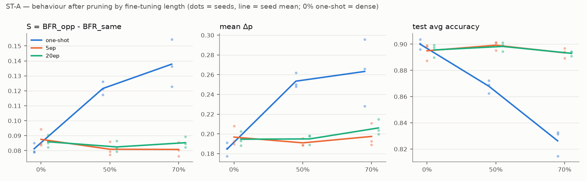

# P4 — stress test (ST-A, ST-B, ST-C)

생성: `analyze_stress.py`. CLAUDE.md §4 "2026-11-10 결정 사항" 10. 판정 규칙은 STEP 3·5 와 같다 (`analyze_h1.py`, `analyze_h2.py`).

**기본 결론**: H1 ≤70% ft0 대비 변함 없음 / H2a 70% Grad-CAM·IG 지지 안 됨, RISE 반대(추적 강화) / H2b 70% 세 방법 모두 변화 > 잡음, 새 쪽.

ρ = 부분 Spearman ρ(Attr_bg, Δp | area) 의 seed 평균. H2a 방향 기호 ↓ = 기준 모델 CI 아래, ↑ = 위, · = 안.

## 판정 요약

핵심 결론 = H1 S·평균 Δp 변함 없음 / H2a 추적 약화 없음 / H2b 70% 변화 > 잡음 (새 쪽). H2a 의 '지지 안 됨' 과 '반대 (추적 강화)' 는 둘 다 '약화 없음' 이므로 핵심은 같고, 세부 판정이 다르면 따로 적는다.

| stress test | 기본 결론이 유지되는가 |
| --- | --- |
| ST-B 측정 방식 | **ST-B 판정: 기본 결론 유지** — 경계 띠 제외·7×7 에서도 H2a 판정과 H2b 결론이 같다. |
| ST-C IG baseline | **ST-C 판정: 핵심 결론 유지** — IG blur: H2a 약화 없음 (같음), 세부 판정 '지지 안 됨' → '반대 (추적 강화)'; H2b 변화 > 잡음 (새 쪽) (같음). 다만 ρ 수준이 baseline 에 따라 바뀐다 (ft0 +0.010 → -0.095). |
| ST-A fine-tuning 길이 | **ST-A 판정: 핵심 결론 유지** — H1 (5ep ft0 대비) 50% 변함 없음; 70% 변함: d_wrong → S·평균 Δp 변함 없음 / Grad-CAM: H2a 약화 없음 (같음), 세부 판정 '지지 안 됨' → '반대 (추적 강화)'; H2b 변화 > 잡음 (새 쪽) (같음) / IG: H2a 약화 없음 (같음), 세부 판정 '지지 안 됨' → '반대 (추적 강화)'; H2b 변화 > 잡음 (새 쪽) (같음) |

## ST-B — 측정 방식 (마스크 경계 띠, Grad-CAM 7×7)

| 설정 | 기준 ρ | 70% ρ | Δρ [CI] | H2a 판정 (seed 별) | H2b 변화량 / 잡음 중앙값 | 중앙값 차이 [CI] | 평균 Attr_bg 변화 [CI] | H2b |
| --- | --- | --- | --- | --- | --- | --- | --- | --- |
| Grad-CAM · 기본 (224 업샘플) | +0.333 | +0.332 | -0.001 [-0.019, +0.016] | 지지 안 됨 (· · ·) | 0.0361 / 0.0103 | +0.0258 [+0.0245, +0.0269] | -0.0315 [-0.0335, -0.0294] | 변화 > 잡음 (새 쪽) |
| Grad-CAM · 경계 ±3px 띠 제외 | +0.334 | +0.333 | -0.002 [-0.019, +0.015] | 지지 안 됨 (· · ·) | 0.0380 / 0.0108 | +0.0272 [+0.0261, +0.0286] | -0.0343 [-0.0364, -0.0321] | 변화 > 잡음 (새 쪽) |
| Grad-CAM · 7×7 해상도 | +0.332 | +0.331 | -0.001 [-0.019, +0.016] | 지지 안 됨 (· · ·) | 0.0377 / 0.0109 | +0.0268 [+0.0258, +0.0282] | -0.0330 [-0.0351, -0.0308] | 변화 > 잡음 (새 쪽) |
| IG · 기본 | +0.010 | +0.039 | +0.029 [+0.017, +0.043] | 지지 안 됨 (↑ · ·) | 0.0224 / 0.0105 | +0.0119 [+0.0112, +0.0125] | -0.0166 [-0.0174, -0.0159] | 변화 > 잡음 (새 쪽) |
| IG · 경계 ±3px 띠 제외 | +0.011 | +0.041 | +0.030 [+0.018, +0.043] | 지지 안 됨 (↑ · ·) | 0.0240 / 0.0111 | +0.0129 [+0.0122, +0.0137] | -0.0190 [-0.0198, -0.0181] | 변화 > 잡음 (새 쪽) |
| RISE · 기본 (centered) | +0.215 | +0.305 | +0.090 [+0.050, +0.128] | 반대 (추적 강화) (↑ ↑ ↑) | 0.0255 / 0.0146 | +0.0109 [+0.0089, +0.0127] | -0.0098 [-0.0125, -0.0071] | 변화 > 잡음 (새 쪽) |
| RISE · raw 맵 (참고, 결정 11) | +0.109 | +0.112 | +0.003 [-0.047, +0.051] | 지지 안 됨 (· · ·) | 0.0010 / 0.0005 | +0.0006 [+0.0005, +0.0007] | -0.0005 [-0.0008, -0.0002] | 변화 > 잡음 (새 쪽) |
| RISE · raw 맵 + 띠 제외 | +0.088 | +0.096 | +0.008 [-0.036, +0.050] | 지지 안 됨 (· · ·) | 0.0010 / 0.0004 | +0.0006 [+0.0004, +0.0007] | -0.0005 [-0.0008, -0.0002] | 변화 > 잡음 (새 쪽) |

- RISE 의 띠 제외 값은 raw 맵에서만 저장돼 있어 raw 맵과 비교한다. raw 맵 자체는 sanity 를 통과하지 못해(결정 11) 판정에 넣지 않고 참고로만 싣는다.

- Grad-CAM · 경계 ±3px 띠 제외: H2a 핵심 같음, H2b 같음
- Grad-CAM · 7×7 해상도: H2a 핵심 같음, H2b 같음
- IG · 경계 ±3px 띠 제외: H2a 핵심 같음, H2b 같음
- RISE · raw 맵 + 띠 제외 (raw 맵과 비교): H2a 핵심 같음, H2b 같음

**ST-B 판정: 기본 결론 유지** — 경계 띠 제외·7×7 에서도 H2a 판정과 H2b 결론이 같다.

## ST-C — IG baseline (검정 → blur σ=10px)

| 설정 | 기준 ρ | 70% ρ | Δρ [CI] | H2a 판정 (seed 별) | H2b 변화량 / 잡음 중앙값 | 중앙값 차이 [CI] | 평균 Attr_bg 변화 [CI] | H2b |
| --- | --- | --- | --- | --- | --- | --- | --- | --- |
| IG · 검정 baseline (기본) | +0.010 | +0.039 | +0.029 [+0.017, +0.043] | 지지 안 됨 (↑ · ·) | 0.0224 / 0.0105 | +0.0119 [+0.0112, +0.0125] | -0.0166 [-0.0174, -0.0159] | 변화 > 잡음 (새 쪽) |
| IG · blur baseline | -0.095 | -0.049 | +0.046 [+0.032, +0.059] | 반대 (추적 강화) (↑ ↑ ↑) | 0.0213 / 0.0105 | +0.0109 [+0.0102, +0.0115] | -0.0128 [-0.0135, -0.0121] | 변화 > 잡음 (새 쪽) |

| 모델 | 평균 Attr_bg 검정 | 평균 Attr_bg blur |
| --- | --- | --- |
| ft0 | 0.6325 | 0.5784 |
| 70% | 0.6158 | 0.5656 |

**ST-C 판정: 핵심 결론 유지** — IG blur: H2a 약화 없음 (같음), 세부 판정 '지지 안 됨' → '반대 (추적 강화)'; H2b 변화 > 잡음 (새 쪽) (같음). 다만 ρ 수준이 baseline 에 따라 바뀐다 (ft0 +0.010 → -0.095).

## ST-A — fine-tuning 길이 (one-shot / 5 epoch / 20 epoch)

### 행동 지표 (seed 평균, 괄호 = 정확도 기준 통과 seed 수)

| sparsity | 재학습 | n | avg | WGA | S | d_correct | d_wrong | 평균 Δp |
| --- | --- | --- | --- | --- | --- | --- | --- | --- |
| 0% | one-shot (= dense) | 3 (3) | 90.00 | 66.25 | 0.0812 | 0.0421 | 0.4335 | 0.1846 |
| 0% | 5ep | 3 (3) | 89.49 | 67.29 | 0.0875 | 0.0456 | 0.4452 | 0.1967 |
| 0% | 20ep | 3 (3) | 89.56 | 67.45 | 0.0859 | 0.0446 | 0.4406 | 0.1946 |
| 50% | one-shot | 3 (0) | 86.79 | 59.66 | 0.1216 | 0.0666 | 0.4831 | 0.2534 |
| 50% | 5ep | 3 (3) | 89.92 | 66.30 | 0.0809 | 0.0422 | 0.4262 | 0.1909 |
| 50% | 20ep | 3 (3) | 89.83 | 67.39 | 0.0825 | 0.0430 | 0.4313 | 0.1949 |
| 70% | one-shot | 3 (0) | 82.63 | 14.17 | 0.1378 | 0.0812 | 0.4069 | 0.2632 |
| 70% | 5ep | 3 (3) | 89.34 | 65.94 | 0.0808 | 0.0428 | 0.3994 | 0.1974 |
| 70% | 20ep | 3 (3) | 89.30 | 67.39 | 0.0853 | 0.0455 | 0.4173 | 0.2060 |

실질 크기 기준 (dense seed 표준편차 × 2): S 0.0069, d_correct 0.0045, d_wrong 0.0138, 평균 Δp 0.0135

### 짝지은 비교 (같은 seed, two-way bootstrap 95% CI, ★ = H1 규칙상 변함)

| 비교 | seed (정확도 통과) | ΔS | Δd_correct | Δd_wrong | Δ평균 Δp | 판정 |
| --- | --- | --- | --- | --- | --- | --- |
| one-shot 50% − dense | 0,1,2 (0) | +0.0403 [+0.0325, +0.0483] ★ | +0.0245 [+0.0181, +0.0307] ★ | +0.0495 [+0.0215, +0.0780] ★ | +0.0688 [+0.0615, +0.0760] ★ | 변함: S, d_correct, d_wrong, 평균 Δp (정확도 미달 seed 포함, 참고) |
| one-shot 70% − dense | 0,1,2 (0) | +0.0566 [+0.0426, +0.0706] ★ | +0.0391 [+0.0285, +0.0504] ★ | -0.0266 [-0.0723, +0.0214] | +0.0786 [+0.0615, +0.0939] ★ | 변함: S, d_correct, 평균 Δp (정확도 미달 seed 포함, 참고) |
| 5ep ft0 − dense | 0,1,2 (3) | +0.0063 [+0.0037, +0.0089] | +0.0035 [+0.0014, +0.0056] | +0.0117 [+0.0006, +0.0224] | +0.0121 [+0.0108, +0.0134] | 변함 없음 |
| 5ep 50% − 5ep ft0 (H1 기준) | 0,1,2 (3) | -0.0066 [-0.0115, -0.0017] | -0.0033 [-0.0074, +0.0005] | -0.0191 [-0.0396, +0.0012] | -0.0058 [-0.0092, -0.0024] | 변함 없음 |
| 5ep 70% − 5ep ft0 (H1 기준) | 0,1,2 (3) | -0.0067 [-0.0145, +0.0010] | -0.0028 [-0.0089, +0.0031] | -0.0458 [-0.0775, -0.0138] ★ | +0.0007 [-0.0061, +0.0075] | 변함: d_wrong |
| 20ep 50% − ft0 (STEP 3 재현) | 0,1,2 (3) | -0.0035 [-0.0085, +0.0014] | -0.0016 [-0.0054, +0.0019] | -0.0092 [-0.0293, +0.0112] | +0.0003 [-0.0029, +0.0037] | 변함 없음 |
| 20ep 70% − ft0 (STEP 3 재현) | 0,1,2 (3) | -0.0006 [-0.0081, +0.0070] | +0.0009 [-0.0047, +0.0067] | -0.0233 [-0.0525, +0.0076] | +0.0114 [+0.0056, +0.0174] | 변함 없음 |
| 5ep 50% − 20ep 50% | 0,1,2 (3) | -0.0015 [-0.0035, +0.0002] | -0.0007 [-0.0022, +0.0006] | -0.0052 [-0.0133, +0.0030] | -0.0040 [-0.0045, -0.0034] | 변함 없음 |
| 5ep 70% − 20ep 70% | 0,1,2 (3) | -0.0045 [-0.0088, -0.0003] | -0.0027 [-0.0061, +0.0003] | -0.0178 [-0.0355, -0.0010] ★ | -0.0086 [-0.0114, -0.0058] | 변함: d_wrong |
| 5ep 70% − one-shot 70% | 0,1,2 (0) | -0.0570 [-0.0706, -0.0436] ★ | -0.0384 [-0.0491, -0.0283] ★ | -0.0075 [-0.0511, +0.0359] | -0.0658 [-0.0807, -0.0503] ★ | 변함: S, d_correct, 평균 Δp (정확도 미달 seed 포함, 참고) |

정확도 기준 통과 5 epoch 모델: 0% seed [0, 1, 2], 50% seed [0, 1, 2], 70% seed [0, 1, 2]

### 5 epoch 모델의 히트맵 (기준 = 5 epoch ft0)

| 설정 | 기준 ρ | 70% ρ | Δρ [CI] | H2a 판정 (seed 별) | H2b 변화량 / 잡음 중앙값 | 중앙값 차이 [CI] | 평균 Attr_bg 변화 [CI] | H2b |
| --- | --- | --- | --- | --- | --- | --- | --- | --- |
| Grad-CAM · 20 epoch (기본) | +0.333 | +0.332 | -0.001 [-0.019, +0.016] | 지지 안 됨 (· · ·) | 0.0361 / 0.0103 | +0.0258 [+0.0245, +0.0269] | -0.0315 [-0.0335, -0.0294] | 변화 > 잡음 (새 쪽) |
| Grad-CAM · 5 epoch | +0.335 | +0.359 | +0.024 [+0.006, +0.043] | 반대 (추적 강화) (↑ · ↑) | 0.0381 / 0.0105 | +0.0276 [+0.0266, +0.0287] | -0.0310 [-0.0331, -0.0290] | 변화 > 잡음 (새 쪽) |
| Grad-CAM · 5 epoch, 50% (참고) | +0.335 | +0.342 | +0.007 [-0.004, +0.019] | 지지 안 됨 (· · ·) | 0.0113 / 0.0105 | +0.0008 [+0.0003, +0.0011] | -0.0068 [-0.0082, -0.0056] | 변화 > 잡음 (새 쪽) |
| IG · 20 epoch (기본) | +0.010 | +0.039 | +0.029 [+0.017, +0.043] | 지지 안 됨 (↑ · ·) | 0.0224 / 0.0105 | +0.0119 [+0.0112, +0.0125] | -0.0166 [-0.0174, -0.0159] | 변화 > 잡음 (새 쪽) |
| IG · 5 epoch | +0.014 | +0.074 | +0.060 [+0.047, +0.075] | 반대 (추적 강화) (↑ ↑ ↑) | 0.0250 / 0.0107 | +0.0143 [+0.0135, +0.0150] | -0.0161 [-0.0170, -0.0152] | 변화 > 잡음 (새 쪽) |
| IG · 5 epoch, 50% (참고) | +0.014 | +0.019 | +0.005 [-0.003, +0.012] | 지지 안 됨 (· · ·) | 0.0112 / 0.0107 | +0.0004 [+0.0001, +0.0008] | -0.0052 [-0.0056, -0.0048] | 변화 > 잡음 (새 쪽) |

'50% (참고)' 행의 '70% ρ' 열과 H2b 는 50% 모델 값이다.

| 방법 | 평균 Attr_bg 5ep ft0 | 5ep 50% | 5ep 70% | 20ep ft0 | 20ep 70% |
| --- | --- | --- | --- | --- | --- |
| Grad-CAM | 0.6577 | 0.6509 | 0.6267 | 0.6572 | 0.6257 |
| IG | 0.6326 | 0.6274 | 0.6165 | 0.6325 | 0.6158 |

**ST-A 판정: 핵심 결론 유지** — H1 (5ep ft0 대비) 50% 변함 없음; 70% 변함: d_wrong → S·평균 Δp 변함 없음 / Grad-CAM: H2a 약화 없음 (같음), 세부 판정 '지지 안 됨' → '반대 (추적 강화)'; H2b 변화 > 잡음 (새 쪽) (같음) / IG: H2a 약화 없음 (같음), 세부 판정 '지지 안 됨' → '반대 (추적 강화)'; H2b 변화 > 잡음 (새 쪽) (같음)

